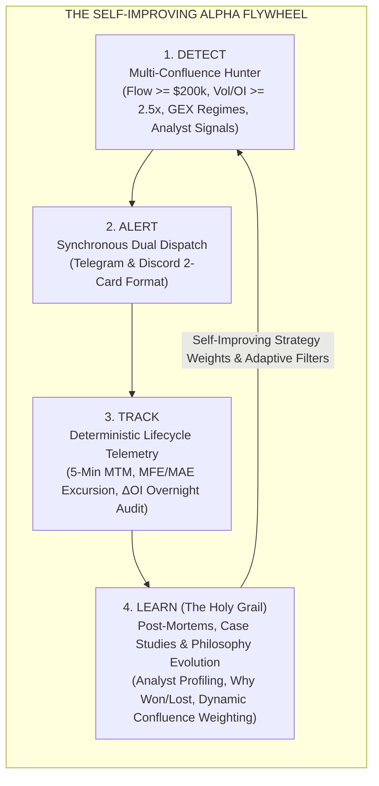
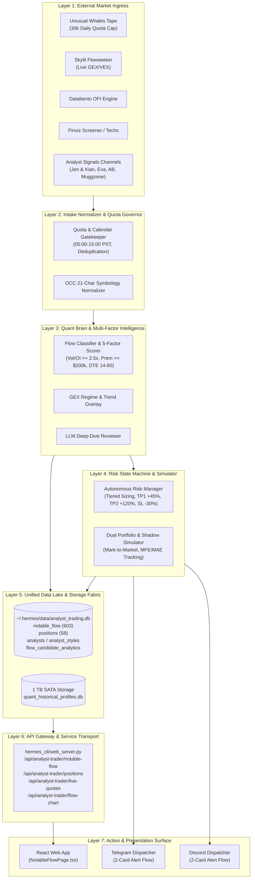
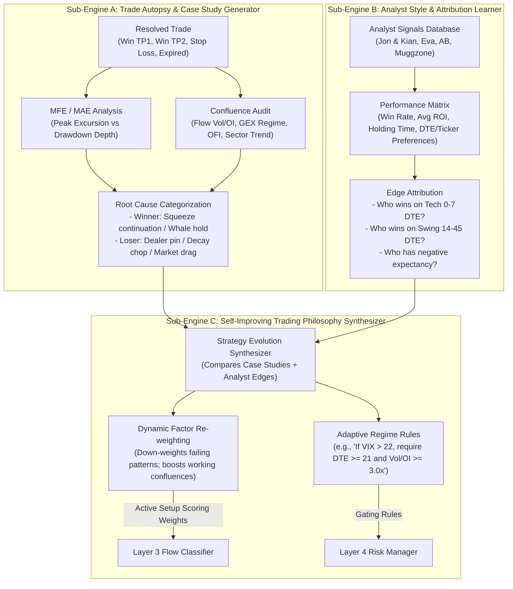
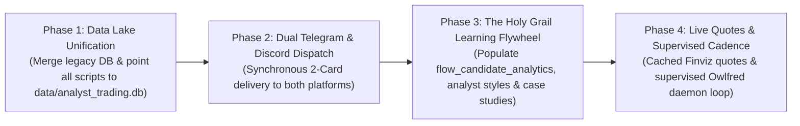

# MBSE System Architecture & Workstream Flow Specification
## Autonomous Market Intelligence & Quantitative Trading Engine ("Owlfred")

---

## 1. System Operational Concept (ConOps) & Mission Objective

### 1.1 Mission Objective
The primary mission of the **Autonomous Market Intelligence & Quantitative Trading Engine** ("Owlfred" / Notable Flow System) is to execute a **self-improving quantitative alpha flywheel** that systematically asserts the ability to:
1. **Detect Tradeable Setups**: Ingests multi-source institutional options flow, gamma exposure (GEX/VEX), order flow imbalances (OFI), market microstructure, and human analyst signals across market channels.
2. **Alert Setups**: Synchronously broadcasts high-impact, actionable 2-card alerts to **BOTH Telegram and Discord** (Card 1: Thesis, OCC 21-character symbology, and Tape Chart; Card 2: Tiered Risk Management and Contract Sizing).
3. **Track Lifecycle Telemetry**: Deterministically logs and marks-to-market every candidate position, measuring intraday MFE (Maximum Favorable Excursion), MAE (Maximum Adverse Excursion), TP1 (+45%), TP2 (+120%), Stop Loss (-30%), and pre-market next-day Open Interest ($\Delta$OI) carryover.
4. **Learn & Self-Improve ("The Holy Grail")**: Performs rigorous post-mortems and case studies on all tracked items and individual human analysts (Jon & Kian, Eva, AB, Muggzone, etc.). Evaluates *why* winning trades succeeded and *why* losing trades failed, evolving the core trading philosophy and dynamically adapting confluence weights so the system gets smarter and compounds a high win-rate edge over time.



---

## 2. The 7-Layer Functional Architecture



---

## 3. Operational Lifecycle Regimes

The system executes across five distinct temporal regimes synchronized to the US Equity Options Calendar (`America/New_York`):

| Regime | Time Window (PST / ET) | Primary Subsystem Actions | Target Artifact / DB Output |
| :--- | :--- | :--- | :--- |
| **1. Pre-Market Audit** | 06:15 PT / 09:15 ET | `PremarketOIAuditor` queries OCC $\Delta$OI changes on yesterday's candidates. Classifies positions as *Whale Carryover* vs *Scalp Flip*. | Updates `notable_flow.next_day_oi`, `oi_delta`, `is_carried_over`. |
| **2. Market Open Ingress** | 06:30–07:00 PT / 09:30–10:00 ET | Ingests institutional tape & analyst signals. Vol-to-OI filters, OCC normalization, baseline contract pricing. | Populates `notable_flow` and `raw_messages` with fresh records. |
| **3. Intraday Risk Triage** | 07:00–12:30 PT / 10:00–15:30 ET | Continuous 60s ingestion polling; 5-minute mark-to-market price updates; MFE/MAE position tracking; TP1/TP2 exit triggers. | Emits **Telegram & Discord** 2-card alerts; updates `positions` and `simulated_positions`. |
| **4. Power Hour Settlement** | 12:30–13:00 PT / 15:30–16:00 ET | Late-day sweep detection; trailing stop adjustments; end-of-day shadow portfolio reconciliation. | Finalizes intraday peak/trough prices (`entry_price`, `peak_price`, `trough_price`). |
| **5. Night Lab ("The Holy Grail")** | 15:00–18:00 PT / 18:00–21:00 ET | **Self-Improving Learning Loop**: 1) Analyst attribution analysis, 2) Win/Loss trade post-mortems & case studies, 3) Adaptive confluence weight updates. | Populates `flow_candidate_analytics`, updates `analyst_styles`, writes learning hypotheses. |

---

## 4. The Holy Grail: Post-Market Learning & Strategy Evolution Engine

The learning engine is not merely a statistical summary—it is the **core intelligence evolution loop** designed to achieve a verifiable, high-win-rate edge:



### 4.1 Trade Case Study Schema (`flow_candidate_analytics` & Post-Mortems)
For every tracked candidate, the learning engine persists a structured post-mortem:
*   **Identification**: `analytics_id`, `flow_id`, `ticker`, `contract_symbol`.
*   **Execution Metrics**: `entry_price`, `peak_price`, `trough_price`, `mfe_pct` (Max Favorable Excursion), `mae_pct` (Max Adverse Excursion).
*   **Microstructure & Tape**: `intraday_vol`, `initial_oi`, `next_day_oi`, `oi_change_pct`, `is_overnight_hold` (Whale Carryover vs Scalp Flip).
*   **Outcome & Autopsy**: `outcome_label` (`WIN_TP1`, `WIN_TP2_RUNNER`, `STOP_LOSS`, `TIME_EXPIRED`), `win_loss_reasoning` (e.g., *"Call sweep failed due to heavy call resistance pin at $150 strike and adverse market drag on FOMC day"*).
*   **Confluence Fingerprint**: `correlations_json` containing factor state at entry (Vol/OI bucket, DTE bucket, GEX alignment, sector momentum).

### 4.2 Analyst Style & Strategy Learning (`analyst_styles`)
For every human analyst channel:
*   **Win Rate & Expectancy**: Empirical win rate and average ROI over 30d / 90d / all-time windows.
*   **Sweet Spot Profile**: Preferred tickers, optimal DTE window (e.g., 0-7 DTE vs 14-45 DTE), average holding hours.
*   **Attribution Rule**: Dynamically categorizes analyst setups so the system knows when an analyst's alert provides high confluence vs when it should be de-prioritized.

---

## 5. Comprehensive Workstream Decomposition & Gap Traceability Matrix

| Workstream Piece | Input Payload | Transform / Component | Output Artifact | Dependencies | Current Status | Failure Mode / Identified Gap |
| :--- | :--- | :--- | :--- | :--- | :--- | :--- |
| **1.1 Unusual Whales Stream** | REST / WS market tape | `flowseeker_unified_ingestion.py` / `uw_notable_flow_mirror.py` | Raw flow records | UW API Key (30k/day cap) | ⚠️ **Throttled / Paused** | Crons paused; uncoordinated polling risks daily quota drain. |
| **1.2 Skylit Flowseeker** | Webhook / API live GEX/VEX | [flow_ingestion_engine.py](file:///Users/admin/repos/hermes-agent/skills/financial/autonomous-trader/scripts/flow_ingestion_engine.py) | High-conviction tape + charts | Skylit session / scraper | ⚠️ **Partially Active** | Browser tab open (`app.skylit.ai`), but ingest loop relies on ad-hoc script runs. |
| **1.3 Databento OFI Ingress** | L3 market depth packets | [databento_ofi_engine.py](file:///Users/admin/repos/hermes-agent/plugins/analyst_trader/databento_ofi_engine.py) | Order Flow Imbalance metric | Databento API token | ✅ **Module Ready** | Standalone module implemented; needs continuous pipeline wiring. |
| **1.4 Finviz Market Metrics** | Ticker symbol | [finviz_fetcher.py](file:///Users/admin/repos/hermes-agent/plugins/analyst_trader/finviz_fetcher.py) | Price, ATR, Sector, RSI | HTML parser / API | ✅ **Operational** | Working, but `/api/analyst-trader/live-quotes` currently returns dummy zeros instead of calling fetcher. |
| **1.5 Analyst Signal Ingress**| Discord messages | [auto_updater.py](file:///Users/admin/repos/hermes-agent/plugins/analyst_trader/auto_updater.py) / `scrapers/` | Records in `raw_messages`, `positions` | Discord bot / user token | ✅ **Ingest Operational** | Ingestion into SQLite works; needs integration into post-market learning engine. |
| **2.1 Quota Governor** | Raw API requests | `flowseeker_unified_ingestion.py:QuotaManager` | Rate-limited execution | State cache file | ✅ **Hardened** | Daily cap enforced; stops after 30k calls. |
| **2.2 Ingress Deduplication** | Flow records | `AnalystDatabase.save_notable_flow` | `UNIQUE(ticker, strike, call_put, exp, trade_timestamp)` | SQLite constraint | ✅ **Operational** | 603 unique rows saved in `~/.hermes/data/analyst_trading.db`. |
| **2.3 OCC Symbology Builder** | Ticker, exp, strike, type | `autonomous_risk_manager.generate_occ_symbol()` | 21-char OCC string (e.g. `METC  260918C00012000`) | String formatter | ✅ **Verified** | Standardized 21-char format compliant with OCC specs. |
| **3.1 5-Factor Flow Classifier** | Flow metrics | [flow_classifier.py](file:///Users/admin/repos/hermes-agent/skills/financial/autonomous-trader/scripts/flow_classifier.py) | `flow_score` (0-100), Tier | `analyst_trading.db` | ⚠️ **Path Disconnected** | Hardcoded to legacy `~/.hermes/analyst_trading.db` instead of `~/.hermes/data/analyst_trading.db`. |
| **3.2 GEX Trend Overlay** | Spot, strike, gamma curve | [gex_downstream_overlay.py](file:///Users/admin/repos/hermes-agent/plugins/analyst_trader/gex_downstream_overlay.py) | `gex_regime` string (LONG_GAMMA, VOL_SUPPRESSION) | Option chain data | ✅ **Module Ready** | Schema has `gex_regime` column; needs continuous pipeline wiring. |
| **3.3 LLM Deep-Dive Reviewer** | High-score flow records | [llm_deep_dive_analyzer.py](file:///Users/admin/repos/hermes-agent/skills/financial/autonomous-trader/scripts/llm_deep_dive_analyzer.py) | `llm_review_status`, `llm_reasoning` | Hermes LLM client | ⚠️ **Path Disconnected** | Hardcoded to legacy root DB path. |
| **4.1 Risk Manager & Sizing** | Flow candidate record | [autonomous_risk_manager.py](file:///Users/admin/repos/hermes-agent/skills/financial/autonomous-trader/scripts/autonomous_risk_manager.py) | Tiered contract sizes (<$1k, $1k-$5k, $5k+), TP1/TP2, SL | Math / Sizing model | ⚠️ **Discord-Only / Ad-Hoc** | Generates cards, but outputs only to Discord; must synchronously dispatch to **Telegram AND Discord**. |
| **4.2 Mark-to-Market Tracker**| Open positions | [price_updater.py](file:///Users/admin/repos/hermes-agent/plugins/analyst_trader/price_updater.py) | Updated `current_price`, `unrealized_pnl` | UW / Finviz price feeds | ⚠️ **Paused** | Cron is disabled; only runs when supervisor is manually launched. |
| **4.3 Shadow Paper Simulator** | Approved trade triggers | [paper_simulator.py](file:///Users/admin/repos/hermes-agent/plugins/analyst_trader/paper_simulator.py) | `positions` table updates | `analyst_trading.db` | ⚠️ **Split DB Target** | Writes to `simulated_positions.sqlite` and `analyst_trading.db` unevenly. |
| **5.1 Unified Data Lake** | All pipeline records | `~/.hermes/data/analyst_trading.db` | WAL SQLite Database | Local NVMe SSD | ⚠️ **Dual-Database Split** | Two DBs exist: `~/.hermes/analyst_trading.db` (107MB, 149 flows, 114 positions) vs `~/.hermes/data/analyst_trading.db` (12.4MB, 603 flows, 58 positions). |
| **5.2 SATA Cold Storage Cache** | Historical quant profiles | `/Volumes/Macintosh 1 TB HD/hermes_storage/` | `quant_historical_profiles.db` | External HD mount | ✅ **Operational** | Profile database exists and is readable when mounted. |
| **5.3 Post-Market Learning DB** | Settled flow outcomes | `flow_candidate_analytics` & `analyst_styles` | Analytics records (MFE/MAE, $\Delta$OI, case studies) | `CandidateCorrelationEngine` + `AnalystStyleLearner` | ❌ **EMPTY (0 Rows)** | Engine has never populated `flow_candidate_analytics` due to cron pause and path disconnect. |
| **6.1 Notable Flow API Endpoint** | HTTP GET query | `hermes_cli/web_server.py:api_analyst_trader_notable_flow` | JSON `{"ok": true, "flows": [...]}` | `data/analyst_trading.db` | ✅ **Hardened & Active** | Auth gated with session token, deduplicating window function, sanitized. |
| **6.2 Positions API Endpoint** | HTTP GET query | `hermes_cli/web_server.py:api_analyst_trader_positions` | JSON `{"ok": true, "positions": [...]}` | `data/analyst_trading.db` | ✅ **Hardened & Active** | Auth gated, returns open and historical positions. |
| **6.3 Live Quotes API Endpoint** | HTTP GET `?tickers=...` | `hermes_cli/web_server.py:api_analyst_trader_live_quotes` | JSON `{"ok": true, "quotes": {...}}` | Live pricing feed | ⚠️ **Mock Placeholder** | Returns stub `{price: 0, change_pct: 0}`. Needs real lightweight cache resolution. |
| **6.4 Flow Chart File Endpoint** | HTTP GET `/{flow_id}` | `hermes_cli/web_server.py:api_analyst_trader_flow_chart` | PNG / WEBP image stream | Path traversal confinement | ✅ **Hardened & Active** | Confined strictly to `~/.hermes/` and `hermes_storage`. |
| **7.1 Notable Flow React Page** | REST API calls | [NotableFlowPage.tsx](file:///Users/admin/repos/hermes-agent/web/src/pages/NotableFlowPage.tsx) | Interactive Dashboard Table | Browser DOM | ✅ **Loaded & Responsive** | Full sorting, multi-select filtering, chart popups, dynamic DTE calculations. |
| **7.2 Flow Candidate Analytics UI** | REST API calls | (Pending dedicated tab / card in UI) | Analytics & Win-Rate Visualization | `flow_candidate_analytics` | ⚠️ **Missing UI Surface** | Data table is currently empty; UI lacks a dedicated case study / correlation view. |
| **7.3 Dual Alert Dispatch** | Candidate setup | `autonomous_risk_manager.py` | 2 Cards to **BOTH Telegram & Discord** | Telegram & Discord Bot APIs | ⚠️ **Partial / Discord-Only** | Needs unified dual-dispatch wrapper ensuring synchronous delivery to both channels. |

---

## 6. Interface Control Document (ICD) Contracts

### ICD-01: Dual-Dispatch 2-Card Alert Contract (Telegram & Discord)
*   **Card 1 (Setup Thesis & Tape Context)**:
    *   Header: `🦉 OWLFRED INSTITUTIONAL FLOW ALERT: ${TICKER} ${STRIKE}${C/P} ${EXP}`
    *   OCC: `OCC: ${generate_occ_symbol()}`
    *   Metrics: Premium USD, Vol/OI ratio, Sweep flag, GEX regime, Confluence Score.
    *   Thesis: 2-3 sentence institutional rationale with catalyst/support level.
    *   Attachment: Flowseeker high-res chart image.
*   **Card 2 (Execution & Position Sizing Engine)**:
    *   Header: `🛡️ OWLFRED RISK & SIZING SPECIFICATION`
    *   Account Tier 1 (<$1,000): 1 Contract | Max Risk: -$35 | Target 1 Exit (100%) or Trail Stop
    *   Account Tier 2 ($1,000–$5,000): 2 Contracts | Trim 1 at TP1 (+45%), Trail 1 to TP2 (+120%)
    *   Account Tier 3 ($5,000+): 3–5 Contracts | Trim at TP1 (100% Free-Roll), Trail Runners
    *   Non-negotiable Hard Stop: -30% Mark-to-Market.

### ICD-02: Trade Case Study & Learning Contract (`flow_candidate_analytics`)
```json
{
  "analytics_id": "an_NVDA_20260917_001",
  "flow_id": "flow_uw_NVDA_20261016_145C",
  "ticker": "NVDA",
  "contract_symbol": "NVDA  261016C00145000",
  "flow_tier": "TIER_1_WHALE",
  "conviction_score": 88.5,
  "entry_price": 4.50,
  "peak_price": 7.20,
  "trough_price": 3.80,
  "mfe_pct": 60.0,
  "mae_pct": -15.5,
  "intraday_vol": 14200,
  "initial_oi": 4150,
  "next_day_oi": 12800,
  "oi_change_pct": 208.4,
  "is_overnight_hold": 1,
  "outcome_label": "WIN_TP1",
  "autopsy_notes": "Succeeded due to heavy gamma squeeze above $140 and overnight whale carryover.",
  "correlations_json": "{\"vol_oi_bucket\": \">3x\", \"dte_bucket\": \"14-30\", \"gex_alignment\": true, \"analyst_confluence\": \"Jon & Kian\"}"
}
```

---

## 7. Phased Critical Path to Operational Readiness



### Phase 1: Data Lake & Script Path Unification (The Bedrock)
1. **Unify Dual SQLite Databases**: Merge legacy `~/.hermes/analyst_trading.db` (107MB, 149 flows, 114 positions) into canonical `~/.hermes/data/analyst_trading.db` (12.4MB, 603 flows, 58 positions). Deduplicate `notable_flow`, `positions`, `analysts`, and `analyst_styles`.
2. **Reconcile Script Paths**: Update all modules in `skills/financial/autonomous-trader/scripts/` (`flow_classifier.py`, `autonomous_risk_manager.py`, `candidate_correlation_engine.py`, `owlfred_engine.py`, `llm_deep_dive_analyzer.py`) to resolve DB path via `plugins.analyst_trader.db.get_db_path()`.
3. **Archive Legacy Database**: Archive the legacy root file to `~/.hermes/data/analyst_trading.db.legacy_backup` and place a protective symlink.

### Phase 2: Synchronous Dual Alert Dispatch (Telegram & Discord)
1. **Unify Dispatch Engine**: In `autonomous_risk_manager.py` and `alert_card_generator.py`, create a unified dispatcher function that sends Card 1 (Thesis + OCC + Chart) and Card 2 (Risk & Sizing Schedule) synchronously to **BOTH Telegram and Discord**.
2. **High-Fidelity Rendering**: Render clean Markdown for Telegram and native rich embeds for Discord.
3. **Automated Pipeline Trigger**: Connect `autonomous_risk_manager.py` to trigger automatically when `flow_classifier.py` approves a setup ($\ge 75$ score, $\ge \$200k$ premium).

### Phase 3: The Holy Grail Learning Engine & Strategy Evolution
1. **Populate `flow_candidate_analytics`**: Run `CandidateCorrelationEngine` over all 603 historical flows to populate MFE/MAE, initial/next-day OI changes, and outcome labels.
2. **Implement Analyst Style Learning**: Run `AnalystStyleLearner` over all closed positions across Jon & Kian, Eva, AB, Muggzone to populate `analyst_styles` with empirical win rates, hold times, and optimal DTE/tickers.
3. **Case Study & Trade Autopsy Generator**: Build the post-mortem analysis function to evaluate *why* each trade won or lost (confluence factors, GEX regime, delta OI carryover) and generate actionable hypotheses for adapting setup weights.
4. **Expose Analytics API**: Add `/api/analyst-trader/flow-candidates` and `/api/analyst-trader/analyst-styles` to `hermes_cli/web_server.py`.

### Phase 4: Live Quotes & Supervised Cadence
1. **Bridge Live Quotes in `web_server.py`**: Replace the `{price: 0, change_pct: 0}` mock in `api_analyst_trader_live_quotes` with a 60-second cached quote resolver backed by `FinvizFetcher`.
2. **Configure Supervised Cadence**: Harmonize execution via `owlfred_supervisor.py`, enforcing market hours (05:00–15:00 PST / 08:00–18:00 ET) and the 30k UW quota limit.
