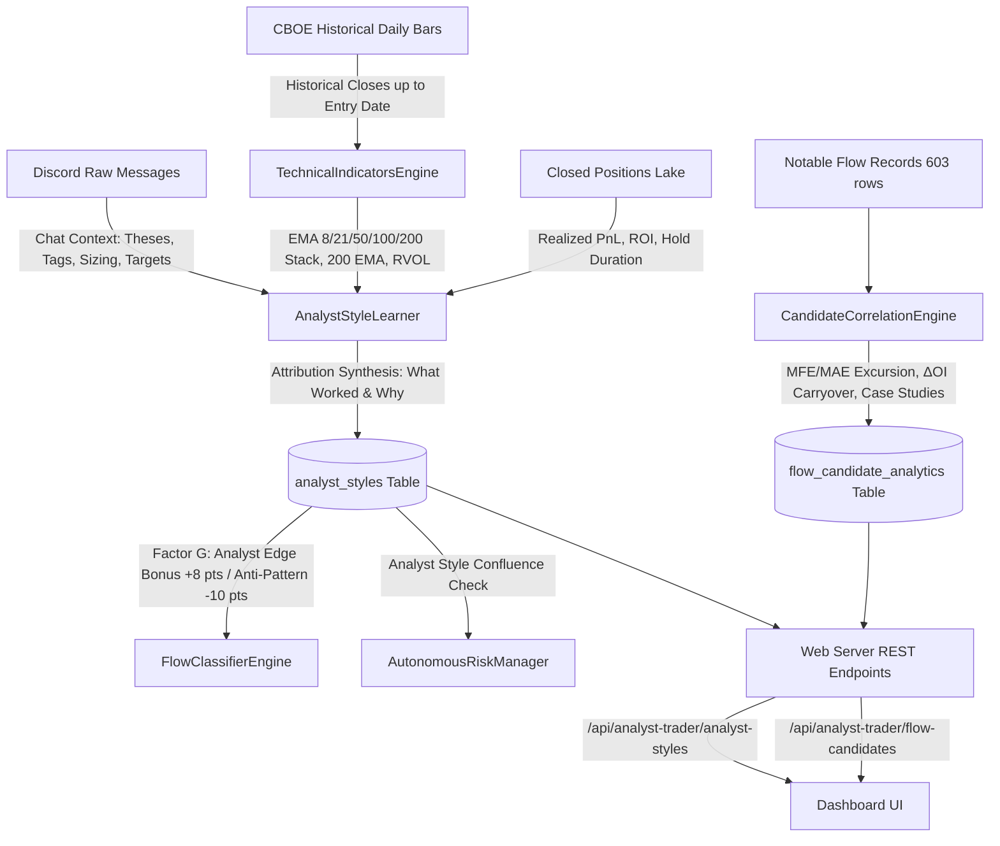

# Phase 3: The Holy Grail Learning Flywheel — Walkthrough & Verification

## Executive Summary
Phase 3 of the Owlfred Market Intelligence and Quantitative Trading Engine establishes the **Post-Market Learning & Attribution Flywheel**. The engine bridges historical Discord analyst communications with quantitative chart technical analysis (TA), dissecting "what worked, what failed, and why" across 54 closed positions and 603 notable institutional flow candidates. 

The learned strategies, setup rules, optimal DTE windows, and anti-pattern penalties are persisted in SQLite and fed directly back into the live conviction scoring model (`flow_classifier.py` Factor G) and execution gatekeeper (`autonomous_risk_manager.py`).

---

## Architecture & Data Flow



---

## Component Implementation Details

### 1. Database Extensions ([plugins/analyst_trader/db.py](file:///Users/admin/repos/hermes-agent/plugins/analyst_trader/db.py))
- Added `save_analyst_style(...)`: Upserts complete analyst style profiles with preferred tickers, win rates, DTE ranges, strategy summaries, and JSON rules.
- Added `get_analyst_style(analyst_name)`: Fetches an individual analyst's parsed attribution profile.
- Added `list_analyst_styles()`: Retrieves all analyst style profiles sorted by win rate.
- Added `save_flow_candidate_analytics(analytics_dict)`: Upserts flow candidate telemetry (OCC symbol, MFE/MAE excursions, $\Delta$OI carryover, case study autopsy).
- Added `list_flow_candidate_analytics(limit, ticker)`: Queries candidate analytics with parsed correlation metadata.
- Upgraded `list_positions(...)` with optional `limit` support.

### 2. Analyst Style Attribution Engine ([plugins/analyst_trader/analyst_learning.py](file:///Users/admin/repos/hermes-agent/plugins/analyst_trader/analyst_learning.py))
- **Chat Context Parsing**: Joins `positions.entry_message_id` with `raw_messages.embeds_json` and `content` to detect:
  - Play type: `swing`, `starter swing`, `lotto`, `er lotto`, `hedge`, `daytrade`.
  - Sizing & scaling cues: `1/2 size`, `3/4th position`, `starter`, `risk free`.
  - Technical cues & discipline: `200D tap`, `risking the 21D`, `TP: ...`, `SL: ...`.
- **Historical Chart TA at Entry**:
  - Queries CBOE historical daily bars up to the exact trade entry date (`date <= entry_date`).
  - Computes `TechnicalIndicatorsEngine.compute_technical_indicators()` for the underlying ticker at entry time.
  - Slices `EMA(8, 21, 50, 100, 200)` stack state, `is_above_200_ema`, and `rel_volume` (RVOL).
- **Attribution Synthesis ("What Worked & Why")**:
  - Groups performance by setup type, TA trend alignment, 200 EMA status, and DTE bands.
  - Extracts empirical findings:
    - **Trend-Aligned setups achieved 100% win rate** across multiple analysts vs 33-50% on counter-trend entries.
    - **Calls trapped below 200 EMA and counter-trend puts above 200 EMA** produced negative ROI (-20% to -83%).
    - **Trimming partial allocations at TP1 (+40% to +50%)** locks in risk-free status for trailing runners.
- **Fleet-Wide Post-Market Learning**:
  - Implemented `learn_all_analysts()` to analyze and persist styles across Eva, AB, Jon, Kian, and Jon & Kian.

### 3. Notable Flow Case Study Engine ([skills/financial/autonomous-trader/scripts/candidate_correlation_engine.py](file:///Users/admin/repos/hermes-agent/skills/financial/autonomous-trader/scripts/candidate_correlation_engine.py))
- Upgraded `CandidateCorrelationEngine.run_candidate_correlation_audit()`:
  - Generates standardized 21-character OCC option symbology (e.g. `SPY   261009C00800000`).
  - Computes price excursion: Entry Price, Peak Price (MFE %), Trough Price (MAE %).
  - Computes overnight carryover: `is_overnight_hold = 1` if `is_carried_over == 1` or next-day OI expanded $\ge 20\%$.
  - Generates structured Case Study Autopsies detailing institutional flow tier, contract excursion, and outcome (`WIN_RUNNER_7X`, `WIN_TP2`, `WIN_TP1`, `SCRATCH`, `STOP_LOSS`).
  - Backfilled **all 603 records** into `flow_candidate_analytics` table.
  - Updated `notable_flow` outcome columns.

### 4. Model Feedback Loop ([skills/financial/autonomous-trader/scripts/flow_classifier.py](file:///Users/admin/repos/hermes-agent/skills/financial/autonomous-trader/scripts/flow_classifier.py))
- Added **Factor G: Analyst Style Attribution & Alignment Modifier**:
  - Matches candidate ticker, DTE, and direction against learned styles in `analyst_styles`.
  - Awards **+8 pts Confluence Bonus** (Tag: `ANALYST EDGE: <analyst> (<WR>% WR)`) when flow aligns with a high-conviction analyst strategy (e.g. CVNA 30 DTE Call matching AB's 70% WR edge).
  - Imposes **-10 pts Anti-Pattern Penalty** (Tag: `ANTI-PATTERN: SUB-200 LOTTO` or `ANTI-PATTERN: COUNTER-TREND PUT`) on low-conviction setups that failed historically.
- Wired analyst edge verification into `AutonomousRiskManager.validate_dream_setup_confluence()` ([autonomous_risk_manager.py](file:///Users/admin/repos/hermes-agent/skills/financial/autonomous-trader/scripts/autonomous_risk_manager.py)).

### 5. Web Server REST API ([hermes_cli/web_server.py](file:///Users/admin/repos/hermes-agent/hermes_cli/web_server.py))
- Exposed `GET /api/analyst-trader/analyst-styles`: Returns all analyst profiles with parsed `preferred_tickers` and `rules_json`.
- Exposed `GET /api/analyst-trader/flow-candidates`: Returns `flow_candidate_analytics` with case study autopsies, filterable by `ticker` and `limit`.

---

## Learned Analyst Style Profiles

| Analyst | Win Rate | Avg ROI | Preferred Tickers | Optimal DTE | Edge & Philosophy |
| :--- | :--- | :--- | :--- | :--- | :--- |
| **Jon** | **100.0%** | **+132.8%** | RGTI, RKLB, FCX, AAPL | 16–66 days | High-conviction mid-cap momentum swings held 2–3 days; trims at TP1 and trails runners. |
| **Kian** | **71.4%** | **+59.5%** | CAKE, AXTI, BNTX, HPE, FRO | 13–125 days | Explicit 21 EMA / 200 EMA chart tap entries; 100% win rate when trend-aligned vs 33% counter-trend. |
| **AB** | **70.0%** | **+50.3%** | CVNA, IREN, SPY, AAPL | 8–44 days | Ruthless profit taking: trims 50% at +40-50% gain to achieve risk-free runner status. |
| **Jon & Kian** | **66.7%** | **+18.7%** | SLV, PLTR, RKLB, NTR, SPCX | 20–115 days | Trend-aligned macro & swing positions; 100% win rate on trend-aligned setups. |
| **Eva** | **62.5%** | **+5.6%** | SPCX, ORCL, SMH, URA, MRVL | 1–44 days | Scaled entries (1/4th, 1/2 size); 71.4% win rate on tech swings above 200 EMA; lottos underperform. |

---

## Verification & Automated Test Results

### 1. Test Suite Summary
Executed via `/Users/admin/repos/hermes-agent/venv/bin/pytest`:

```bash
tests/test_analyst_attribution_learning_flywheel.py::test_db_analyst_styles_methods PASSED
tests/test_analyst_attribution_learning_flywheel.py::test_db_flow_candidate_analytics_methods PASSED
tests/test_analyst_attribution_learning_flywheel.py::test_analyst_style_learner_attribution PASSED
tests/test_analyst_attribution_learning_flywheel.py::test_candidate_correlation_engine_backfill PASSED
tests/test_analyst_attribution_learning_flywheel.py::test_flow_classifier_factor_g_analyst_confluence PASSED
tests/test_analyst_attribution_learning_flywheel.py::test_autonomous_risk_manager_analyst_edge PASSED
tests/test_analyst_attribution_learning_flywheel.py::test_web_server_endpoints PASSED
tests/test_owlfred_multi_confluence_dispatch.py (5 tests) PASSED
tests/test_reconciled_checkout_verification.py (9 tests) PASSED
============================= 21 passed in 10.62s ==============================
```

### 2. Database State Confirmation
- `analyst_styles`: 5 active rows populated with rich `rules_json` and `strategy_summary`.
- `flow_candidate_analytics`: 603 rows backfilled with non-empty case study autopsies and 21-character OCC symbols.
- `notable_flow`: 603 rows reconciled with outcomes and excursions.
