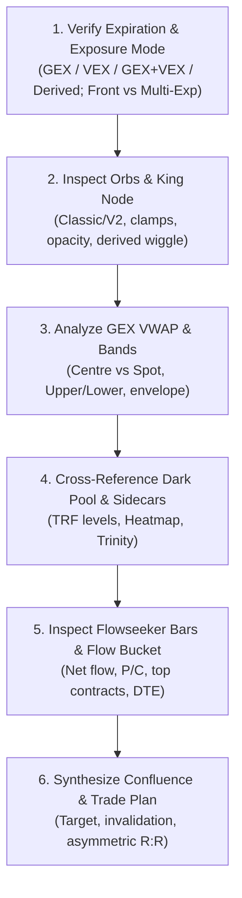

# Skylit Atlas Interactive Charting & Multi-Layer Confluence Analysis

## Source of Truth

Use the official Skylit docs as the ground truth before analyzing, configuring, or explaining Atlas:

- Docs index: `https://docs.skylit.ai/llms.txt`
- Atlas overview: `https://docs.skylit.ai/atlas/overview.md`
- Drawing Presets: `https://docs.skylit.ai/atlas/drawing-presets.md`
- GEX VWAP: `https://docs.skylit.ai/atlas/indicators/gex-vwap.md`

If the app UI or docs disagree with this skill, trust the live docs/UI and patch this skill immediately.

## Overview

Use this skill to analyze **Skylit Atlas**, the visual multi-layer charting hub inside Skylit Terminal. Atlas brings charting directly into Skylit Terminal so users can review price action, dealer positioning, dark pool levels, and options-flow context in one place without switching between Heatseeker, Flowseeker, Dark Pool views, and separate charting tools.

Atlas is a **confluence visibility tool**, not a signal generator. Public docs frame confluence as product visibility: Atlas helps users observe where Skylit data overlaps with chart levels. Applied trade interpretation belongs in Academy-style analysis and must still require price-action confirmation, risk/reward, and invalidation.

---

## When to Use

Load this skill when the user asks to:

- Interpret or analyze a **Skylit Atlas** chart, screenshot, indicator setup, or workspace layout.
- Configure or understand **Orbs**: Classic, Orbs V2, Derived Orbs, King Node visibility, and the Derived Wiggle.
- Read and interpret **GEX VWAP**: Centre line, Upper/Lower lines, Band, Opening Window envelope, Session envelope, Nodes filters, Expirations, and Trinity Combine.
- Evaluate **Flowseeker in Atlas**: intraday flow bars, net flow, and Flow Bucket contract breakdowns.
- Map **Dark Pool TRF levels** as chart support/resistance context.
- Work with **Drawing Presets**: Fibonacci presets, line-style presets, starred defaults, unsaved-change dots, sync, and account limits.
- Work with **Named Chart Layouts**: multi-pane grids, layer toggles, automatic saving, cross-device sync, and `[` / `]` cycling.
- Understand **Projections (Beta)**, **Replay**, **Scroll as Replay**, **Exposure Views**, **Heatmap Sidecar**, and **Trinity Sidecar**.

Do **not** treat Atlas overlays, GEX VWAP, Orbs, Dark Pool levels, Flowseeker bars, or Projections as automated buy/sell signals. They provide visual context of dealer exposure, options flow, and institutional flow that must be confirmed by price action and risk-to-reward.

---

## Core Components & Concepts

### 1. Atlas Ecosystem & Confluence

Atlas acts as a visual hub inside Skylit Terminal. Skylit docs describe Heatseeker, Flowseeker, Agenthub, Nexus, Dark Pool levels, and price action as being integrated directly into charts so users can review relevant data while price action is developing.

- **Heatseeker**: dealer-positioning levels.
- **Dark Pool levels**: areas where large hidden/off-exchange activity may be present.
- **Flowseeker**: where options activity is coming in.
- **Price action**: how the market is reacting in real time.

Analysis rule: describe confluence as overlapping context, then separate observation from actionable trade logic.

### 2. Expirations in Atlas

In Heatseeker, gamma exposure is organized by expiration columns. Atlas projects that same expiration logic onto price charts through the **Expiration** setting.

- **Current**: displays data from the current/front expiration.
- **Current + Next N**: displays current expiration plus a chosen number of upcoming expirations.
- **Further expirations**: can reveal positioning beyond the current contract period.
- **Display difference**: the same strike can look different depending on selected expiration range; changing expiration changes the displayed view, not the underlying data.

Key rule: match the displayed expiration range to the trading context. Front/current is better for intraday/0DTE reads; wider ranges are better for multi-day or swing context.

### 3. Orbs: Heatseeker Overlays on Price

Orbs are visual chart overlays that represent Heatseeker node data inside Atlas. They help users see important heatmap levels directly on the price chart.

#### Orbs Classic

Orbs Classic provides a simpler visual design for node strength.

- Brighter / more intense colors indicate higher-value nodes.
- Duller colors indicate smaller or weaker nodes.
- **Opacity** adjusts maximum brightness/intensity.
- **Orb Size** controls how large the Orbs appear.

#### Orbs V2 Settings

Orbs V2 gives finer control over Heatseeker node visualization.

| Setting | What it controls |
| --- | --- |
| Orb Size | Overall size of Orbs. Higher values make zones larger; lower values keep chart cleaner. |
| Min Clamp | Minimum Orb size. Higher values make smaller nodes easier to see. |
| Max Clamp | Maximum Orb size. Lower values prevent dominant nodes from overwhelming candles. |
| Min Opacity | Visibility of weaker nodes. |
| Max Opacity | Visibility of major nodes. |
| King Opacity | Visibility of the single strongest node, the **King Node**. |

#### Scroll as Replay

When **Scroll as Replay** is enabled, Orbs V2 only uses information available at the selected historical point as the user scrolls backward. This avoids future data influencing the replay and is useful for reviewing how dealer positioning developed throughout a session.

### 4. Derived Orbs & The Wiggle

Some Atlas charts use derived exposure: the chart borrows GEX/VEX levels from a related product.

| Chart/Product | Borrowed or related levels |
| --- | --- |
| ES | Can borrow levels from SPXW / SPY. |
| NQ | Can borrow levels from QQQ. |
| SPY | Levels can be seen on SPXW. |
| SPXW | Levels can be seen on SPY. |

**The Wiggle**: because ES, NQ, SPX, SPY, SPXW, and QQQ do not move perfectly together, borrowed levels may shift slightly minute to minute as Atlas keeps them aligned with live market movement. This is expected behavior, not an error. If a derived level briefly disappears, the source data may have temporarily dropped; Atlas may hide the level rather than display it in the wrong place.

### 5. GEX VWAP Indicator

GEX VWAP plots the **centre of gravity of dealer positioning** directly on the price chart. Every minute, Atlas takes the option board behind the heatmap and computes the exposure-weighted average strike, with each strike weighted by exposure magnitude.

Important: **GEX VWAP is not a volume VWAP.** No traded share volume is involved. Price VWAP answers “where has volume traded”; GEX VWAP answers “where is the positioning centred.”

#### Adding GEX VWAP

Open the chart settings panel and use **Add** in the Indicators section. GEX VWAP appears alongside moving averages and other Skylit studies. Each instance gets its own settings cog and can be removed the same way.

#### GEX VWAP Lines

| Line | What it is |
| --- | --- |
| Centre | Exposure-weighted average strike across the selected board. |
| Upper | Same average, re-run only over strikes above the Centre. |
| Lower | Same average, re-run only over strikes below the Centre. |
| Envelope | Optional two levels marking how far the band has reached over a chosen window. |

The Upper and Lower lines split the board at the **Centre line itself**, not current price. A minute with no board data renders as a gap, not a stale value.

#### GEX VWAP Settings

| Setting | Options | What it controls |
| --- | --- | --- |
| Expirations | Front only (default), 1W, 1M, 3M, 6M, All | Which expirations feed the average. Wider windows fold in further-dated exposure. |
| Nodes | All (default), P50, P40, P30, P25, P20 | Which strikes feed the lines. P-values include only strikes whose exposure is at least that percent of the King Node, matching GEX Nodes / percent-of-king vocabulary. |
| Band | Band + centre, Centre only | Shows upper/lower lines plus centre, or centre alone. |
| Envelope | Off (default), Opening window, Session | Opening Window measures first N minutes after 09:30 ET open, default 15 and configurable 8–60, then freezes. Session starts at open and only widens through the day. |
| Trinity Combine | SPXW-only | Folds SPY and QQQ exposure into a unified SPX-priced board. |

Reading notes:

- Lines are computed fresh each minute from that minute’s board; they are not smoothed and carry no memory.
- The Centre line is not a price target or signal. It marks where positioning is centred so users can compare market price vs board weight.
- The Opening Window envelope needs at least 8 minutes of board data inside its window; otherwise Atlas draws no envelope rather than a misleading one.

### 6. Projections (Beta)

Projections are a beta Atlas feature that visualizes potential forward price-gravity zones based on selected chart context.

They can show projected forward range, possible upper/lower gravity zones, estimated percentage levels around current price, and a visual path for price-gravity development over the selected projection window.

Available projection length depends on active candlestick timeframe: shorter chart timeframes may support shorter projection windows; higher timeframes may support longer projection views.

Warning: Projections are contextual estimates, not guarantees, signals, or trade recommendations.

### 7. Heatmap & Trinity Sidecars

- **Heatmap Sidecar**: brings Heatseeker-style positioning directly beside the Atlas chart. It can show strike levels, expiration columns, exposure values, high-value nodes, and current price location relative to nearby levels. Common filters include number of expirations shown, number of nodes shown, selected exposure type, and current vs expanded expiration views.
- **Trinity Sidecar**: extends the Heatmap Sidecar by showing related market heatmaps together in one view. Trinity may include related products such as SPX, SPY, and QQQ.

### 8. Flowseeker in Atlas & Flow Bucket

When the Flow toggle is enabled, Flowseeker activity appears beneath the price chart so users can compare options-flow activity with chart movement.

Clicking a flow bar opens **Flow Bucket**, an inline inspector for the selected time window. It may include selected time range, number of trades, net flow, calls and puts, bucket put/call ratio, full-day put/call ratio, top contracts, contract expiration and DTE, and contract premium/notional value.

### 9. Dark Pool Levels

Atlas can display Dark Pool levels directly on the chart. They may appear as horizontal levels with labels showing the associated price area and activity context. Users can toggle Dark Pool levels from the chart toolbar and configure them through the filter icon.

Use Dark Pool levels as another market-structure layer to compare against price action, Heatseeker nodes, Flowseeker activity, and other Atlas overlays.

### 10. Replay, Backtesting & Exposure Views

- **Replay**: lets users move through historical chart action and study how Atlas data appeared at the time. It is for review and education, not proof that future outcomes repeat.
- **Exposure Views**: control which exposure layer appears on the chart.

| View | Description |
| --- | --- |
| GEX | Displays gamma exposure context. |
| VEX | Displays vanna exposure context. |
| GEX + VEX | Combines both exposure views into one chart context. |
| Derived | Uses related products to display derived exposure where supported. |

### 11. Drawing Presets

Drawing Presets save a drawing’s full configuration under a name and sync it across devices signed into the same Skylit account.

| Preset type | Tools covered | What gets saved |
| --- | --- | --- |
| Fibonacci | Fib retracement | Level ratios, per-level colors and visibility, fills and fill opacity, line width and style, extensions, trend line, label options, log scale, reverse. |
| Line style | Trendline, rectangle, arrow, horizontal line, horizontal ray, vertical line, brush | Color, line width, line style, opacity. |

Preset controls:

- **Preset dropdown**: applies a preset to the selected drawing and makes it active. Built-in defaults reset stock configuration.
- **Save as…**: saves selected drawing’s current configuration as a new named preset and makes it active.
- **Update**: overwrites active preset with current drawing configuration; enabled only when the drawing differs from preset.
- **Star**: marks preset as default for all new drawings and takes priority over active selection. Click again to unstar.
- **Delete**: removes preset from account.

Unsaved-change dot:

- Dot visible means the drawing no longer matches the preset. Click **Update** to save changes into preset or re-apply preset to discard them.
- No dot + Update disabled means drawing matches preset exactly.
- Edits never save into a preset automatically. Changing a drawing changes that drawing only until **Update** is clicked.

Defaults for new drawings apply in this order:

1. Starred preset.
2. Active preset when no preset is starred.
3. Built-in defaults.

Applying a preset restyles the selected drawing only. Drawings already on charts keep their own configuration unless selected and re-applied.

Fibonacci color rule: Fibonacci drawings color each level individually; those per-level colors live in the preset. The general drawing color swatch does not apply while a Fibonacci drawing is selected. For line-style presets, color is part of the preset.

Sync and limits:

- Presets sync across all devices signed into the same Skylit account.
- If the same account edits presets on two devices at once, the most recent save wins.
- Accounts can store up to **50 presets across both preset types**.

### 12. Named Chart Layouts

Atlas supports named chart layouts for full workspace states.

Each layout saves:

- Pane arrangement: single chart, side-by-side, stacked, quad, and other multi-chart grids.
- Each pane’s symbol, timeframe, candle style, and overlay settings.
- Active Atlas layers: Orbs, Projections, Flow, Dark Pool levels, Heatmap side panels, Trinity side panels, and other toggles.
- Chart preferences such as timezone and session view.

Layout actions:

| Action | How |
| --- | --- |
| Switch layouts | Click a layout, or press `[` and `]` to cycle previous/next. |
| Create a layout | Use “New layout from current” to save current workspace as a new layout. |
| Rename a layout | Click pencil icon or double-click name, edit, confirm. |
| Delete a layout | Click delete, then confirm; deletion is two-step to prevent accidents. |

There is no Save button. Changes to active layout — symbol, timeframe, toggle, arrangement — are saved automatically shortly after they happen. Layouts are stored with the Skylit account and sync across devices. On mobile, desktop-only arrangements are hidden from the switcher but remain available on desktop.

---

## 6-Step Atlas Confluence Analysis Workflow

Follow this sequence when reviewing an Atlas chart setup or producing a market read:



### 1. Expiration & Exposure Mode Verification

Confirm whether Atlas is rendering **GEX**, **VEX**, **GEX + VEX**, or **Derived** exposure and verify the active Expiration filter: Current/Front, Current + Next N, or wider windows such as 1W/1M/3M/6M/All.

### 2. Orbs & King Node Location

Locate the largest visual Orb (**King Node**) and secondary Orb clusters. For futures or cross-product views, explicitly note whether levels are native or derived and whether wiggle behavior is present.

### 3. GEX VWAP & Positioning Center of Gravity

Compare spot price to the **GEX VWAP Centre Line**:

- Spot above Centre: positioning weight is below price; can act as supportive context if price confirms.
- Spot below Centre: positioning weight is above price; can act as overhead context if price confirms.
- Check whether price is respecting the Upper/Lower lines or testing Opening Window / Session envelope extremes.

### 4. Dark Pool & Sidecar Levels

Identify large off-exchange horizontal levels intersecting Orb clusters or GEX VWAP lines. Check Heatmap/Trinity Sidecars to see whether related products agree or diverge.

### 5. Flowseeker & Flow Bucket Detail

Inspect Flowseeker bars near key level tests. Use Flow Bucket details to validate whether options activity is directional, mixed, call/put concentrated, sweep/block driven, or isolated to specific strikes/expirations.

### 6. Trade Plan Formulation

Combine all layers:

- **Primary Target**: nearest high-value Orb, GEX VWAP band, or confirmed liquidity/flow level.
- **Invalidation**: loss of Dark Pool support/resistance, GEX VWAP Centre, or relevant Orb cluster.
- **Risk-to-Reward**: only take trades with clear asymmetric R:R; avoid midpoint trades when price is floating between key bands with no confluence.

---

## Output Template: Skylit Atlas Visual Read Card

Use this clean output template for Atlas chart summaries:

```markdown
✨ **SKYLIT ATLAS MULTI-LAYER READ — CONFLUENCE ANALYSIS**

**Ticker**: [SYMBOL]
**Spot Price**: $[SPOT_PRICE]
**Active View**: [GEX / VEX / GEX+VEX / Derived]
**Expirations**: [Current / Current + Next N / 1W / 1M / 3M / 6M / All]
**Chart Timeframe**: [1m / 5m / 15m / 1h]

---

🎯 **DEALER POSITIONING & ORBS**
**King Node**: $[STRIKE] ([Above/Below spot], [Fresh/Tested])
**Orb Clusters**: $[STRIKE_RANGE]
**Derived Status**: [Native / Derived from SPXW-SPY-QQQ with expected wiggle / Source data temporarily dropped]

⚖️ **GEX VWAP CENTER OF GRAVITY**
**Centre Line**: $[GEX_VWAP_CENTRE] ([Spot is +X.X% Above / Below])
**Upper / Lower Line**: $[UPPER_LINE] / $[LOWER_LINE]
**Envelope Status**: [Off / Opening Window: $[LOW]-$[HIGH] / Session: $[LOW]-$[HIGH]]

📊 **FLOWSEEKER & DARK POOL CONFLUENCE**
**Dark Pool Levels**: $[DARK_POOL_PRINTS] ([context])
**Net Flow Direction**: [Bullish +$X.XM / Bearish -$X.XM / Neutral]
**Flow Bucket Key Contracts**: [Calls/Puts, Strikes, Expirations, DTE, Premium/Notional]

🔮 **ATLAS CONFLUENCE & TRADE PLAN**
**Structure**: [Bullish Expansion / Range Pin / Bearish Breakdown / Whipsaw / Midpoint Skip]
**Primary Target**: $[TARGET_PRICE]
**Invalidation Level**: $[INVALIDATION_PRICE]
**Risk-to-Reward**: [Asymmetric X:1 / 1:1 Skip]
**Conviction**: [HIGH / MODERATE / LOW]

---
*Educational market-structure analysis powered by Skylit Atlas. Always confirm with price action.*
```

---

## Common Pitfalls & FAQs

1. **Confusing GEX VWAP with price/volume VWAP**: GEX VWAP tracks dealer exposure weight, not traded share volume.
2. **Treating Centre as a target or signal**: Centre is context for where positioning is centered, not a buy/sell trigger.
3. **Forgetting expiration context**: A level can look strong on one expiration view and weak on another.
4. **Treating the wiggle as an error**: Derived levels adjust dynamically to stay aligned with live market relationships.
5. **Over-relying on Projections (Beta)**: Projections show contextual gravity paths, not guaranteed future price paths.
6. **Ignoring missing data gaps**: GEX VWAP gaps mean no board data for that minute; do not forward-fill mentally.
7. **Ignoring unsaved preset changes**: Watch for the small dot and click Update only when you intend to overwrite the preset.
8. **Assuming preset changes update old drawings**: Applying a preset affects selected drawing only.
9. **Assuming layouts need manual saves**: Atlas layouts auto-save after changes.
10. **Trading in the midpoint**: If spot is floating between GEX VWAP Upper and Lower lines with no clear Orb/Flow/Dark Pool confluence, avoid forcing directional trades.
